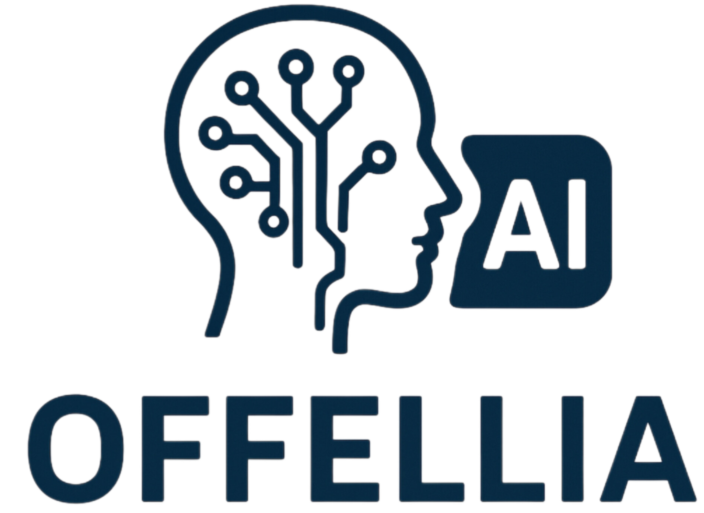

<p align="center">
  
</p>

# Offellia

Fork do llama.cpp com o CLI `llama-agent`. A inferência fica na máquina, a interface web é compilada do código local, e as skills vêm junto com o binário.

A base de compilação, modelos GGUF e servidores continua a do llama.cpp. O guia geral de backends está em [docs/build.md](docs/build.md). O manual do agente está em [tools/agent/README.md](tools/agent/README.md).

## Clonar e compilar

É preciso CMake, um compilador C++17, Git e, para a GPU, o driver Vulkan com `libvulkan` e o compilador de shaders `glslc`. Node.js entra só na interface web. Se o `npm` não estiver instalado, essa etapa é pulada e o CLI ainda é gerado.

```sh
git clone https://github.com/brunoconta1980-tech/llama-agent-offellia.git
cd llama-agent-offellia

cmake -B build -DGGML_VULKAN=ON
cmake --build build -j
```

A pasta `build/` não vai no Git. Ela é criada nesse comando. Os executáveis saem em `build/bin/`.

| Programa | Caminho |
| --- | --- |
| Agente | `build/bin/llama-agent` |
| CLI de conversa | `build/bin/llama-cli` |
| Servidor HTTP compatível com a API OpenAI | `build/bin/llama-server` |
| Binário unificado | `build/bin/llama` |

Para compilar só na CPU, omita `-DGGML_VULKAN=ON`.

## Usar o agente

```sh
./build/bin/llama-agent -m /caminho/modelo.gguf
```

Um modelo publicado no Hugging Face também serve, quando a máquina pode baixá-lo:

```sh
./build/bin/llama-agent -hf usuario/modelo-GGUF
```

Com Vulkan compilado, o backend entra no binário e é usado se o driver enxergar a placa. `-ngl N` define quantas camadas vão para a GPU. `./build/bin/llama-agent --help` lista o restante das opções, inclusive contexto, threads e o endereço de um `llama-server` já em execução (`--server-base`).

Dentro da sessão, `/skills` mostra as skills carregadas. `/help` mostra os comandos do agente.

## Skills

A compilação copia `tools/agent/bundled-skills/` para `build/bin/skills/`. Na próxima abertura, o agente lê essa pasta sozinho. A ordem de busca é:

1. `./.llama-agent/skills/`
2. `./.agents/skills/`
3. `~/.llama-agent/skills/`
4. `~/.agents/skills/`
5. a pasta `skills/` ao lado do executável
6. diretórios extras passados com `--skills-path`

O primeiro nome encontrado prevalece. Uma skill no projeto ou na conta substitui a que veio com o binário.

As skills incluídas são `build-with-ai`, `create-skill`, `create-workflow`, `design`, `docx`, `execute-plan`, `game-assets`, `learn`, `long-running-background-tasks`, `pdf`, `pptx`, `resume-claude`, `resume-codex`, `resume-cursor`, `review`, `skill-design-principles`, `statusline` e `threejs-frame-conventions`. Cada uma tem `SKILL.md` e um script em Python da biblioteca padrão.

## O que este fork altera

- A interface web sai do código deste repositório. O download de um pacote pronto da UI fica desligado.
- `llama update` não chama instalador remoto.
- A PWA não fica sondando atualização, e o favicon já gravado não é reescrito por cima quando é mais novo que o logo.
- `--tools` e `--agent` não forçam a lista de CORS para localhost. A restrição só vale se `--cors-origins` for passado.
- No agente, shell, leitura, escrita e caminho fora do diretório de trabalho são permitidos por padrão. Uma recusa marcada na sessão atual continua valendo só naquele processo.
- O texto do console usa verde fósforo. Na abertura, o nome OFFELLIA aparece em ASCII ao lado do logo do agente.

## Licença

MIT. O texto está em [LICENSE](LICENSE). A base do motor é o [llama.cpp](https://github.com/ggml-org/llama.cpp).
